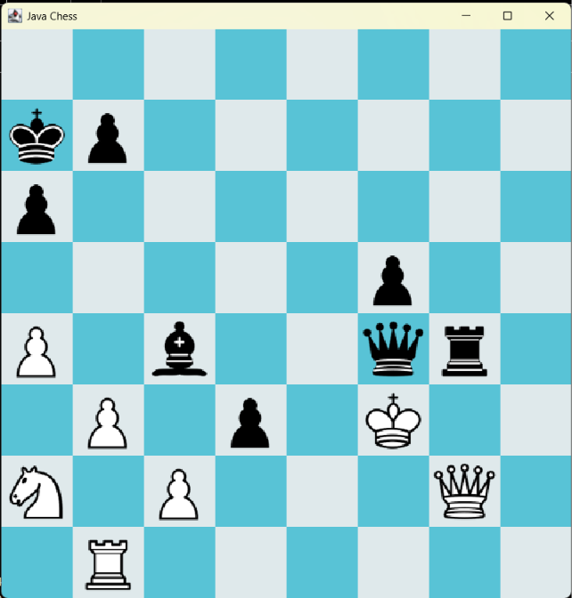

# JavaChess



This is a revival of a custom chess engine and bot that I wrote over twenty years ago and has been gathering dust since then.
It includes a chess engine to run the game and a very basic chess bot to play against
I thought it might be a fun learning project to get it going again. 
My goal was also to integrate StockFish as another bot and play my bot vs StockFish to judge its strength. 

The core chess engine, architecture and bot was coded by me by hand.
I used AI to generate some of the tedious IO code (like move or FEN parsing) and stockfish integration, which was subsequently reviewed and corrected.
AI was also used to review the code, suggest improvements and explain new concepts.

### Features

* Chess engine: Custom implementation of the chess board, pieces, and game logic.
* Move validation: Parse player moves, resolve any move ambiguity and validate that player moves are legal
* Engine handles castling, enpassant capture and pawn promotion (including underpromotion)
* Engine implements check and checkmate detection, all draw detection including 50 move rule and threefold repetition
* Player architecture: Support for different player implementations, including human players and computer opponents.
* A basic custom chess bot: A computer opponent that evaluates board positions and searches possible moves to select its next move.
* Stockfish integration: Support for using Stockfish as an opponent
* Setting up positions using FEN notation, and saving to FEN for testing
* Saving games in standard PGN format that can be loaded into other chess programs
* Playing human vs bot or bot vs bot games
* Ability to play bot vs bot in multigame tournaments and collect stats
* GUI or console display, or suppress display for bot tournaments


### Architecture

The code is organised into three main packages:

```text
java/
├── engine/
│   ├── board/       - Represents the chessboard and its state
│   ├── game/        - Manages the game loop
│   ├── moves/       - Parses, resolves, validates and represents moves
│   ├── pieces/      - Chess piece classes
│   └── players/     - Human and computer player implementations
├── io/
│   ├── SANFormatter - Formats moves in Standard Algebraic Notation
│   └── PGNWriter    - Saves games in PGN format
└── ui/
    └──              - Console and graphical user interfaces
```

#### Console output

If the console UI is enabled then the board is displayed like this:


When running bot vs bot tournament with the GUI and Console board disabled, it will show game results like this:


### Technology used

* Java
* Object-oriented design
* JUnit 5 (testing)
* Stockfish integration (external chess engine)

### Building and running
JDK 25 is required
ConsoleChess in the UI package is main entry point. Run this to run the engine.
You'll currently need to modify this code to define the players, specify the number of games in the tournament, and whether the GUI and/or console messages should be displayed while running.
To use the stockfish player, you will need to install the stockfish engine and then copy its executable to the engines/stockfish folder. The path to the exe is defined by STOCKFISH_PATH in StockFishPlayer.

### BotPlayer
This current player is a very crude implementation.
It does a full scan of the move tree (no pruning) and as such can only look a few plies ahead or it takes too long as the number of possible positions to examine grows rapidly with each additional ply.
It evaluates each leaf node using a very simple algorithm.
If win - score = 1000
if lose - score = 0
otherwise a score is calculated between these two numbers using a combination of material strength and piece mobility.
It plays legal chess but is by no means a strong player.

### Building a new bot

Create a new player class in the players package that extends ChessPlayer
Implement getAction to return your players action based on the board (and move history - required for stockfish) passed to it.
In ConsoleChess create an instance of your player and pass it into the Tournament constructor.
Run ConsoleChess and see how well your player does against a human or another bot.

### Unit Tests
Units test that have been developed so far are:

* CastlingTests - test castling rules are implemented correctly
* EnPassantTests - test enpassant rules are implemented correctly
* FENtests - test saveToFEN is producing the expected results
* MateTests - currently just tests that bot passes simple mate in 1 test
* MoveParserTest - test that the MoveParser correctly parses a SAN move string
* MoveResolverTest - test MoveResolver passes moves it can resolve, and rejects ambiguous moves
* MoveValidatorTest - currently just has a fools mate test
* PromotionTests - test pawn promotion moves
* StockfishEngineTest - test stockfish integration

### History

#### Getting it running again

This is a revival of a Java 1.4 applet that I built over 20 years ago that plays chess, which was ported from an earlier chess engine that I wrote in C++ that displayed simple ASCII characters for the board and pieces

I haven't written any Java code since then, but have worked a lot in C# and other similar languages

To do this I first had to install JDK 25  (Eclipse Temurin), and then I installed the Intellij IDEA development environment.

Java applets are no longer supported so this interface was discarded, but the code to display the ASCII board still existed and I quickly got this running again, and then won a game against the computer.
This initial version was committed to Github

#### Refactoring the architecture

I then realised my old code needed some serious refactoring.
Firstly the existing Army class had too many responsibilities. It was mixture of UI, reading human moves and calculating computer moves. Some of these methods were moved into the existing Board class (that represents the current state of the chessboard), and others belonged to the player.
I created a new abstract ChessPlayer class and moved methods to new derived classes HumanPlayer or BotPlayer as appropriate. The Army class was then abolished. 

I also created a new ChessGame class to run the game between two ChessPlayers.

I then decided I needed to do big refactor to change the way the board references pieces.
It was using a fixed array with predetermined slots (e.g. slots 0 - 7 = pawns, 8- 15 for the pieces), but this was clunky for custom board positions,and also didn't work very well if a pawn got promoted.
I changed this to a variable length list of pieces, and created new methods to make it easier to place pieces on in the board.

I also decided to change the way I check for enpassant, and just record an enpassant target square on the board if a pawn has move two squares, instead of recording on the pawn whether it move 2 squares last turn.

#### Writing to PGN

I also realised that it would be beneficial to be able to save games in the PGN (Portable Game Notation) format, so that I would be able to load them into sites like Chess.com to analyse them.
To do this I created a new PGNWriter class. 
After doing this I played simple fools mate game and saved it to a file, and then confirmed then pgn file can be loaded into chess.com

#### Changing input to standard chess notation
I decided to change the way I input moves from my clunky notation e.g Pe2-e4 to instead use standard algebraic notation (e.g. e4). 
This involved changing the way I parse the input string and I created MoveParser, MoveResolver and MoveValidator classes.
I used AI to help write the tedious MoveParser logic, but found it got the logic wrong here so bxf6 was confused with Bxf6.

#### Adding unit tests
I also added a lot of unit tests to ensure that the engine is handling all chess rules correctly including castling, enpassant capture, promotion.
I also added other tests for move parsing, resolution of ambiguous moves, and validation that moves are legal.

The tests uncovered an issue with castling, the code to see whether the king moves through a square that is under attack was not working correctly. 
I rewrote the way this is done and resolved this issue.

#### Adding a GUI
I then decided to add a graphical UI to make it easier to read the board when playing a game against the computer. 
This was done using the swing library and using the wikipedia chess icons

#### Stockfish integration
After doing this, I installed the stockfish chess engine and created the StockFishPlayer and StockFishEngine classes to interface to it.
I tried playing my bot against stockfish at its lowest setting. I found my bot to be not very competitive, but did get some wins.
So far I've spent most of my time cleaning up and enhancing the engine code, and very little time on improving my bot which currently is using a very crude search and evalution method. 

#### Other enchancements
Other enhancements that I added to the engine are the ability play a "tournament" between two bots of a specified number of games and record summary stats.
I also added checks for draws by 50 move rule, or repetition of position 3 times. 
Other improvements are the ability to populate a board from FEN format, or save to FEN, and formatting a move with correct disambiguation and displaying + for check or # for mate, when displaying in console or saving to PGN file.

### Possible Future Development

* Create a web front end so people can try this out and play against my bots
* Build a better bot - e.g. using negamax search with alpha-beta pruning and better evaluation algorithm
* Benchmarking bot vs stockfish at various strengths
* Test bot - get it to solve various sets of puzzles
* Add ability to setup game using config file
* Read FEN / PGN files to load games and positions

### License
This project is licensed under the MIT License.


